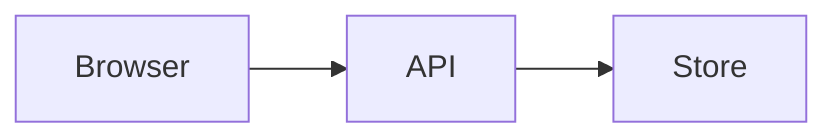

# Notes

Source for [crasnec.github.io](https://crasnec.github.io/), a static Astro blog
for long-form engineering notes.

The site includes:

- Markdown and MDX posts
- Syntax highlighting with Expressive Code
- Mermaid diagrams and KaTeX equations
- Categories, tags, archives, pagination, and a table of contents
- Pagefind full-text search
- Generated Open Graph images and favicons
- Author-encrypted posts
- Moderated comments stored in a separate GitHub repository
- Automatic deployment to GitHub Pages

## Articles and developer fixtures

The published collection contains the fourteen-chapter [Think Stats series](https://crasnec.github.io/categories/statistics/).
Its sources, notebook data and figure data live in `src/content/posts/Statistics/`.

Runtime and figure demonstrations live in `src/fixtures/posts/build/`, outside
the published collection. To serve these examples for browser regression tests,
stop any normal development server and start the fixture site explicitly:

```bash
npm run astro -- dev stop
BLOG_POSTS_DIR=./src/fixtures/posts npm run astro -- dev --background
npm run test:playground:browser
npm run test:figures:browser
npm run test:locale:browser
```

Restart without `BLOG_POSTS_DIR` to return to the published articles. Ordinary
builds, search results and the sitemap never include these fixtures.
See [`src/playground/README.md`](src/playground/README.md) and
[`src/figures/README.md`](src/figures/README.md) for component examples.

## Requirements

- Node.js 22.23.4 or newer (`.nvmrc` selects Node.js 24, matching CI)
- npm
- Git

## Local development

Install dependencies and fetch the comment store:

```bash
npm install
npm run comments:pull
```

Start Astro in background mode:

```bash
npm run astro -- dev --background
```

Manage the background server with:

```bash
npm run astro -- dev status
npm run astro -- dev logs
npm run astro -- dev stop
```

Useful checks:

```bash
npm run check      # Native TypeScript, Astro checking, ESLint, and tests
npm run check:types # Native TypeScript and Astro checking
npm run tsc -- --version # Show the native TypeScript compiler version
npm run lint       # ESLint only
npm run lint:fix   # Apply safe ESLint fixes
npm test           # Node test suite
npm run build
npm run preview
```

TypeScript 7.0.2 checks JavaScript and TypeScript through the native CLI, using
Astro's strictest configuration. `npm run check:types` generates Astro types,
runs the native checker, and then checks Astro templates with `astro check`.
`npm run tsc -- --noEmit` explicitly selects the native compiler without relying
on whichever `tsc` binary npm hoists.

Astro's checker, typed ESLint, and the browser playground still require the
TypeScript 6 compiler API. The `typescript` dependency therefore uses Microsoft's
`@typescript/typescript6` compatibility package, while `@typescript/native`
selects TypeScript 7. The compatibility API resolves to 6.0.3 in the lockfile;
the playground uses it for syntax checking and transpilation, not full type checking.
See [Microsoft's migration guidance](https://devblogs.microsoft.com/typescript/announcing-typescript-7-0/#running-side-by-side-with-typescript-6-0).

ESLint applies type-aware strict and stylistic rules to JavaScript, TypeScript
and Astro, plus accessibility rules to components. External messages and runtime
results are validated before use. Markdown and encryption boundaries have focused
tests. The deployment workflow runs the complete check before building.

`npm run build` creates the static site in `dist/` and then builds the Pagefind
index. Use `npm run build:clean` after changing a remark or rehype plugin, the
content schema or the active theme.

Search and table-of-contents browser checks run without a development server:

```bash
npm run test:search:browser
npm run test:contents:browser
```

These checks require Playwright Chromium. They load the actual browser scripts
through intercepted requests and cover keyboard navigation, Korean input
composition, search failures, and mobile section links.

## Code style

Authored project files use spaces for indentation, and `.editorconfig` selects
four spaces for every file type. JavaScript, TypeScript, TSX and Astro code also
uses semicolons and a maximum line length of 100 characters.
Lines containing URLs, strings, template literals or regular expressions are
exempt from the length limit. Comments otherwise follow the same 100-character
limit. Control-flow bodies use braces and span multiple lines. Adjacent function
declarations, exported functions, variable-bound arrow/function expressions, and
class methods are separated by one blank line. Consecutive empty lines are limited
to one. Ordinary data fields and variables need no extra spacing; concise arrow
bodies and object-literal callbacks remain allowed. Type-safety and accessibility
checks remain enabled.

```bash
npm run lint:fix     # Format source, styles and configuration, then apply ESLint fixes
npm run lint         # Check indentation, formatting, type-safety and accessibility
npm run lint:spacing # Check authored text for indentation tabs
npm run lint:format  # Check stylesheet and configuration formatting
```

Prettier formats CSS and other stylesheets, JSON/JSONC, YAML, HTML and SVG as
well as source code. Its 100-column setting helps wrap code; ESLint enforces
the JavaScript/TypeScript limit with the exceptions above. A few long comments
may still require manual line breaks.

The spacing check covers tracked and unignored new text files, including
Markdown/MDX, Astro comments, downloadable Python sources and notebook data.
It reports indentation tabs without rewriting string values or data separators.
Upstream study inputs are explicitly excluded in `.spacingignore` to retain
their original bytes and checksums. Generated chart/notebook JSON, article prose
and embedded code strings retain their contents instead of being reformatted.
The same settings apply to the blog template.

## Configuration

The interface locale, site metadata, navigation, profile information, and comment limits
live in [`src/config.ts`](src/config.ts).

The active visual theme is selected in
[`src/theme.config.mjs`](src/theme.config.mjs). Theme implementations live under
`src/styles/themes/`.

Copy `.env.example` to `.env` for local comment integration:

```dotenv
PUBLIC_COMMENTS_REPO=Crasnec/blog-comments
PUBLIC_COMMENTS_TOKEN=github_pat_...
```

Never commit `.env`.

The comment form remains visible but disabled until both values are configured.

## Language and date formatting

This blog uses `locale: "ko"` in [`src/config.ts`](src/config.ts). Set it to
`"en"` for the English interface. Rebuild with `npm run build:clean` after
changing it, or restart the background development server.

The setting controls search, comments, locked-post controls,
figure replay controls, code playground controls and status messages,
CodeMirror's find/replace panel, post counts, reading
times, document language, sharing metadata and the search index. Navigation and
section names (Posts, Archive, Categories, Tags, About and Contents) keep this
blog's established English terminology. Category names come directly from post
folders and are excluded from localization. Changing the interface
locale leaves category names and post URLs unchanged.

The shared formatters in [`src/utils/format.ts`](src/utils/format.ts) apply to
listings, archives, articles, comments and generated social images:

| Display | `en` | `ko` |
| --- | --- | --- |
| Full date | October 21, 2026 | 2026년 10월 21일 |
| Compact date | 2026 · 10 · 21 | 2026. 10. 21. |
| Archive month/day | 10 · 21 | 10. 21. |
| Archive year | 2026 | 2026년 |
| Revision in the same year | Updated October 21 | 10월 21일 수정 |
| Revision in another year | Updated October 21, 2027 | 2027년 10월 21일 수정 |
| Post count | 1 post / 2 posts | 1개의 글 / 2개의 글 |
| Reading time | 3 min | 3분 |

Dates use **UTC**, independent of the reader's device timezone. Write
frontmatter dates as ISO `YYYY-MM-DD`. Locale changes their display;
machine-readable `<time datetime>` and JSON-LD dates keep ISO formats.

The locale is selected once per build. It does not create translated posts,
language-prefixed routes or a language switcher. Authored article text, titles,
descriptions, tags, custom profile/site text, and diagram data, units and labels
stay as written. Project documentation and example guides remain in English.
Compiler errors and third-party runtime diagnostics retain their original text.

Pagefind uses the document language for its index. Korean search works, but
this Pagefind release does not provide Korean stemming: related word forms
are not automatically treated as the same search term.

Message catalogs live in [`src/locales/`](src/locales/). Checks require the same
keys and interpolation placeholders in both languages. CodeMirror's phrase map
is in `src/locales/editor.ts`. No additional dependencies are required.

To check the locale in a running production preview, use:

```bash
LOCALE_BASE=http://localhost:4321 EXPECTED_LOCALE=ko npm run test:locale:browser
```

`LOCALE_BASE` selects the server and `EXPECTED_LOCALE` selects the expected
language for the test; neither changes the site configuration. These browser
checks require a Playwright Chromium installation.

## Writing posts

Posts live in `src/content/posts/`. Their full path below that directory becomes
the URL path, so nested directories are preserved.

```text
src/content/posts/databases/redis/cache-invalidation.md
https://crasnec.github.io/posts/databases/redis/cache-invalidation/
```

Frontmatter follows this schema:

```yaml
---
title: Cache invalidation without guesswork
published: 2026-08-22
updated: 2026-08-24
description: A short summary used in listings and metadata.
tags: [caching, performance]
draft: false
---
```

Every directory below `src/content/posts/` is a category level. Folder names
are displayed exactly as authored and are never translated. For example:

```text
src/content/posts/Statistics/Probability/Continuous/normal.mdx
```

This post belongs to **Statistics / Probability / Continuous**. Its category
page is `/categories/statistics/probability/continuous/`; its post URL remains
`/posts/statistics/probability/continuous/normal/`. The parent **Statistics**
page includes posts in all its subcategories. Counts include descendants, even
when no posts are filed directly in a parent folder. The index and sidebar show
the tree; breadcrumbs link back through its ancestors.

No registration or frontmatter category field is needed. URL segments use the
same slugging as Astro post URLs: lowercase, spaces replaced with hyphens and
punctuation removed, with Unicode preserved. Equal leaf names under different
parents are separate categories. Names producing the same URL under the same
parent fail validation. Renaming or moving folders can change URLs. Empty
folders do not appear in the tree. Tags are free-form. Drafts are visible during
development and excluded from production builds.

### Reading order and series

Set `order` to put a post at an author-selected position in the home, category
and tag listings. Lower numbers come first. Posts without a position follow,
newest first. Positions may have gaps or repeat; equal positions use publication
date (newest first), then the post path to break ties. The archive still groups
posts by publication year.

A series has its own name and reading order, independent of the folder category
and the global `order` field:

```yaml
order: 10
series:
  name: Building an operating system
  order: 1
```

Both order fields are optional positive safe integers. Omit the whole `series`
block for a standalone post; when present, its trimmed name and order are
required. Series names are displayed literally and are never translated.
The same series can span category folders. Its parts appear in ascending
`series.order`, with gaps allowed and duplicate part numbers rejected at build
time. Names that produce the same URL also fail the build instead of being
silently merged. Draft parts are omitted from production, including the series
count and previous/next links.

The series label appears on post listings. Articles link to `/series/` and the
series page, and provide a collapsible list with the current part highlighted.
For example, `Think Stats` is available at `/series/think-stats/`; Unicode names
remain in their URL. Previous/next links on a series article stay within that
series. Standalone articles follow the displayed list when any global positions
exist. With no global positions, they retain older/newer chronological navigation.

## Markdown features

Code fences support Expressive Code metadata:

````markdown
```ts title="cache.ts" {2-4}
export function read(key: string) {
  return cache.get(key);
}
```
````

Mermaid fences are rendered as diagrams:

````markdown

````

Admonitions use directives:

```markdown
:::warning
This operation cannot be undone.
:::
```

Supported kinds are `note`, `tip`, `important`, `warning`, and `caution`.

Animated figures (a chart that draws itself, samples piling into a
distribution, requests flowing between services) are placed with
`<Figure kind="…" props={…} />` in an MDX post. See
[`src/figures/README.md`](src/figures/README.md) for the available kinds, how
to write a new one, and `npm run figures:shot`, which captures stills to check
a figure without watching it.

Editable code uses `<CodePlayground language="python" code={source} />` in MDX.
JavaScript, TypeScript and Python run in browser Workers, with output, Stop and
Reset controls. Editors also accept custom JSON or XML/plist TextMate grammars.
See [`src/playground/README.md`](src/playground/README.md) for props, grammar
dependencies, execution behaviour and browser tests.
Python loads packages from the full Pyodide catalog and supports compatible
PyPI wheels through `micropip.install()` or the author's `pythonPackages` prop.
Common scientific packages remain bundled locally with pinned hashes.
JavaScript and TypeScript resolve browser-compatible npm imports through esm.sh.
Plots appear below the editor and can be downloaded as PNG files. Silent runs
keep a compact output area with a visible completion status.

Inline and display mathematics are rendered with KaTeX.

## Locked posts

Locked post plaintext lives in the ignored `secrets/` directory. The committed
post contains only public frontmatter and encrypted content.

Create the keypair once:

```bash
npm run secret:keygen
```

Seal a post:

```bash
npm run secret:seal secrets/private-note.md
```

Open a sealed post for editing:

```bash
npm run secret:open src/content/posts/private/private-note.md
```

Change the passphrase without resealing posts:

```bash
npm run secret:rekey
```

The passphrase is never committed. Losing it makes existing locked posts
unrecoverable.

## Comments

Comments are stored in the public
[`Crasnec/blog-comments`](https://github.com/Crasnec/blog-comments) repository.
The browser dispatches its `comment.yml` workflow, which validates the input and
commits a JSON record with `approved: false`.

Only approved comments are rendered. To publish one, change `approved` to
`true` in the comment repository and commit the change. The next scheduled site
build fetches the store and includes it in the static output.

The comment token is intentionally included in the generated page. It must be a
fine-grained token restricted to `Crasnec/blog-comments` with only
**Actions: read and write**. This still exposes that repository's Actions API to
abuse, so the repository boundary and minimal permission scope are mandatory.

Comment bodies support a restricted Markdown subset. Raw HTML, images, and
unsafe links are removed or neutralized before rendering.

## Deployment

The source repository is private. The workflow in
`.github/workflows/deploy.yml` builds the site and pushes only `dist/` to the
public [`Crasnec/crasnec.github.io`](https://github.com/Crasnec/crasnec.github.io)
repository.

The workflow runs:

- after pushes to `main`
- on manual dispatch
- once per hour to publish newly approved comments

Required Actions secrets in `Crasnec/blog`:

- `PAGES_DEPLOY_KEY`: SSH key used only to publish generated files
- `PUBLIC_COMMENTS_TOKEN`: fine-grained token for the comment workflow

The deployment fails when `PUBLIC_COMMENTS_TOKEN` is missing, preventing a site
with a silently disabled comment form from being published.

## Project structure

```text
.github/workflows/  Build and deployment automation
keys/               Public key and passphrase-wrapped private key
scripts/            Comment sync and locked-post tools
src/components/     Reusable Astro components
src/content/        Posts and standalone pages
src/layouts/        Site and article layouts
src/pages/          Astro routes
src/plugins/        Markdown processing plugins
src/scripts/        Browser-side behavior
src/styles/         Layout, prose, motion, and themes
src/utils/          Content, URL, rendering, and cryptography helpers
src/views/          Shared page views
```

Generated or private directories such as `dist/`, `.astro/`, `.comments/`,
`node_modules/`, `secrets/`, and `.env` are ignored by Git.

## Category hierarchy regression checks

The eight articles in `src/fixtures/categories/` exercise parent counts, deep
paths, equal leaf names under different parents, Unicode names and long mobile
labels. They are outside the published collection. To serve them explicitly,
stop the normal server and run:

```bash
BLOG_POSTS_DIR=./src/fixtures/categories npm run astro -- dev --background
npm run test:categories:browser
```

`CATEGORIES_BASE` can instead point the browser suite at a fixture build.
Screenshots are written to `.figures-shots-category-hierarchy/`. Restart the
server without `BLOG_POSTS_DIR` to return to real articles.

## Lighthouse audits

Build first, then run `npm run audit:lighthouse`. The audit starts a temporary
static server and Playwright Chromium, and closes both on completion or interruption.
Install Chromium with `npx playwright install chromium` when needed.

```sh
LIGHTHOUSE_PATHS='/,/series/,/posts/statistics/think-stats-01/' npm run audit:lighthouse
```

The default runs Lighthouse's standard mobile and desktop presets with all four
categories. Reports are saved in `.cache/lighthouse/` as HTML, raw JSON, and a
summary containing versions, settings, metrics, and failures. The command fails
unless every category scores 100. `LIGHTHOUSE_DIST`, `LIGHTHOUSE_OUTPUT`, and
`LIGHTHOUSE_DEVICES` override the build directory, report directory, and devices.
Local reports measure the production build with gzip and a ten-minute cache;
real hosting, network conditions, content, and browser versions can change scores.
