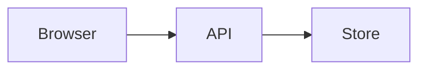

# Notes

Source for [crasnec.github.io](https://crasnec.github.io/), a static Astro blog
for long-form engineering notes.

The site includes:

- Markdown and MDX posts
- Syntax highlighting with Expressive Code
- Mermaid diagrams and KaTeX equations
- Categories, tags, archives, pagination, and a table of contents
- Pagefind full-text search
- Generated Open Graph images and favicons
- Author-encrypted posts
- Moderated comments stored in a separate GitHub repository
- Automatic deployment to GitHub Pages

## Articles and developer fixtures

The published collection contains the fourteen-chapter [Think Stats series](https://crasnec.github.io/categories/statistics/).
Its sources, notebook data and figure data live in `src/content/posts/Statistics/`.

Runtime and figure demonstrations live in `src/fixtures/posts/build/`, outside
the published collection. To serve these examples for browser regression tests,
stop any normal development server and start the fixture site explicitly:

```bash
npm run astro -- dev stop
BLOG_POSTS_DIR=./src/fixtures/posts npm run astro -- dev --background
npm run test:playground:browser
npm run test:figures:browser
npm run test:locale:browser
```

Restart without `BLOG_POSTS_DIR` to return to the published articles. Ordinary
builds, search results and the sitemap never include these fixtures.
See [`src/playground/README.md`](src/playground/README.md) and
[`src/figures/README.md`](src/figures/README.md) for component examples.

## Requirements

- Node.js 22.12 or newer
- npm
- Git

## Local development

Install dependencies and fetch the comment store:

```bash
npm install
npm run comments:pull
```

Start Astro in background mode:

```bash
npm run astro -- dev --background
```

Manage the background server with:

```bash
npm run astro -- dev status
npm run astro -- dev logs
npm run astro -- dev stop
```

Useful checks:

```bash
npm run check      # Astro type checking, ESLint, and tests
npm run lint       # ESLint only
npm run lint:fix   # Apply safe ESLint fixes
npm test           # Node test suite
npm run build
npm run preview
```

TypeScript uses Astro's strictest configuration. ESLint applies type-aware
strict and stylistic rules to TypeScript, plus Astro and accessibility rules to
components. Security-sensitive Markdown and encryption boundaries have focused
tests. The deployment workflow runs the complete check before building.

`npm run build` creates the static site in `dist/` and then builds the Pagefind
index. Use `npm run build:clean` after changing a remark or rehype plugin, the
content schema or the active theme.

## Configuration

The interface locale, site metadata, navigation, profile information, and comment limits
live in [`src/config.ts`](src/config.ts).

The active visual theme is selected in
[`src/theme.config.mjs`](src/theme.config.mjs). Theme implementations live under
`src/styles/themes/`.

Copy `.env.example` to `.env` for local comment integration:

```dotenv
PUBLIC_COMMENTS_REPO=Crasnec/blog-comments
PUBLIC_COMMENTS_TOKEN=github_pat_...
```

Never commit `.env`.

The comment form remains visible but disabled until both values are configured.

## Language and date formatting

This blog uses `locale: "ko"` in [`src/config.ts`](src/config.ts). Set it to
`"en"` for the English interface. Rebuild with `npm run build:clean` after
changing it, or restart the background development server.

The setting controls search, comments, locked-post controls,
figure replay controls, code playground controls and status messages,
CodeMirror's find/replace panel, post counts, reading
times, document language, sharing metadata and the search index. Navigation and
section names (Posts, Archive, Categories, Tags, About and Contents) keep this
blog's established English terminology. Category names come directly from post
folders and are excluded from localization. Changing the interface
locale leaves category names and post URLs unchanged.

The shared formatters in [`src/utils/format.ts`](src/utils/format.ts) apply to
listings, archives, articles, comments and generated social images:

| Display | `en` | `ko` |
| --- | --- | --- |
| Full date | October 21, 2026 | 2026년 10월 21일 |
| Compact date | 2026 · 10 · 21 | 2026. 10. 21. |
| Archive month/day | 10 · 21 | 10. 21. |
| Archive year | 2026 | 2026년 |
| Revision in the same year | Updated October 21 | 10월 21일 수정 |
| Revision in another year | Updated October 21, 2027 | 2027년 10월 21일 수정 |
| Post count | 1 post / 2 posts | 1개의 글 / 2개의 글 |
| Reading time | 3 min | 3분 |

Dates use **UTC**, independent of the reader's device timezone. Write
frontmatter dates as ISO `YYYY-MM-DD`. Locale changes their display;
machine-readable `<time datetime>` and JSON-LD dates keep ISO formats.

The locale is selected once per build. It does not create translated posts,
language-prefixed routes or a language switcher. Authored article text, titles,
descriptions, tags, custom profile/site text, and diagram data, units and labels
stay as written. Project documentation and example guides remain in English.
Compiler errors and third-party runtime diagnostics retain their original text.

Pagefind uses the document language for its index. Korean search works, but
this Pagefind release does not provide Korean stemming: related word forms
are not automatically treated as the same search term.

Message catalogs live in [`src/locales/`](src/locales/). Checks require the same
keys and interpolation placeholders in both languages. CodeMirror's phrase map
is in `src/locales/editor.ts`. No additional dependencies are required.

To check the locale in a running production preview, use:

```bash
LOCALE_BASE=http://localhost:4321 EXPECTED_LOCALE=ko npm run test:locale:browser
```

`LOCALE_BASE` selects the server and `EXPECTED_LOCALE` selects the expected
language for the test; neither changes the site configuration. These browser
checks require a Playwright Chromium installation.

## Writing posts

Posts live in `src/content/posts/`. Their full path below that directory becomes
the URL path, so nested directories are preserved.

```text
src/content/posts/databases/redis/cache-invalidation.md
https://crasnec.github.io/posts/databases/redis/cache-invalidation/
```

Frontmatter follows this schema:

```yaml
---
title: Cache invalidation without guesswork
published: 2026-08-22
updated: 2026-08-24
description: A short summary used in listings and metadata.
tags: [caching, performance]
draft: false
---
```

The first folder below `src/content/posts/` is the category. Its name is shown
exactly as written and never translated. For example,
`Statistics/nested/intro.mdx` belongs to **Statistics**; `nested` remains part of
the post URL. Adding or moving a folder requires no configuration or frontmatter
category field. Category URLs use the same lowercase folder slugs as Astro
post URLs: spaces become hyphens, punctuation is removed and Unicode is
preserved. Different
folder names that produce the same slug cannot be separate categories.
Renaming a folder can change its category and post URLs. Empty folders do not
appear in the category list. Tags are free-form. Drafts are visible during
development and excluded from production builds.

## Markdown features

Code fences support Expressive Code metadata:

````markdown
```ts title="cache.ts" {2-4}
export function read(key: string) {
  return cache.get(key);
}
```
````

Mermaid fences are rendered as diagrams:

````markdown

````

Admonitions use directives:

```markdown
:::warning
This operation cannot be undone.
:::
```

Supported kinds are `note`, `tip`, `important`, `warning`, and `caution`.

Animated figures (a chart that draws itself, samples piling into a
distribution, requests flowing between services) are placed with
`<Figure kind="…" props={…} />` in an MDX post. See
[`src/figures/README.md`](src/figures/README.md) for the available kinds, how
to write a new one, and `npm run figures:shot`, which captures stills to check
a figure without watching it.

Editable code uses `<CodePlayground language="python" code={source} />` in MDX.
JavaScript, TypeScript and Python run in browser Workers, with output, Stop and
Reset controls. Editors also accept custom JSON or XML/plist TextMate grammars.
See [`src/playground/README.md`](src/playground/README.md) for props, grammar
dependencies, execution behaviour and browser tests.
Python loads packages from the full Pyodide catalog and supports compatible
PyPI wheels through `micropip.install()` or the author's `pythonPackages` prop.
Common scientific packages remain bundled locally with pinned hashes.
JavaScript and TypeScript resolve browser-compatible npm imports through esm.sh.
Plots appear below the editor and can be downloaded as PNG files. Silent runs
keep a compact output area with a visible completion status.

Inline and display mathematics are rendered with KaTeX.

## Locked posts

Locked post plaintext lives in the ignored `secrets/` directory. The committed
post contains only public frontmatter and encrypted content.

Create the keypair once:

```bash
npm run secret:keygen
```

Seal a post:

```bash
npm run secret:seal secrets/private-note.md
```

Open a sealed post for editing:

```bash
npm run secret:open src/content/posts/private/private-note.md
```

Change the passphrase without resealing posts:

```bash
npm run secret:rekey
```

The passphrase is never committed. Losing it makes existing locked posts
unrecoverable.

## Comments

Comments are stored in the public
[`Crasnec/blog-comments`](https://github.com/Crasnec/blog-comments) repository.
The browser dispatches its `comment.yml` workflow, which validates the input and
commits a JSON record with `approved: false`.

Only approved comments are rendered. To publish one, change `approved` to
`true` in the comment repository and commit the change. The next scheduled site
build fetches the store and includes it in the static output.

The comment token is intentionally included in the generated page. It must be a
fine-grained token restricted to `Crasnec/blog-comments` with only
**Actions: read and write**. This still exposes that repository's Actions API to
abuse, so the repository boundary and minimal permission scope are mandatory.

Comment bodies support a restricted Markdown subset. Raw HTML, images, and
unsafe links are removed or neutralized before rendering.

## Deployment

The source repository is private. The workflow in
`.github/workflows/deploy.yml` builds the site and pushes only `dist/` to the
public [`Crasnec/crasnec.github.io`](https://github.com/Crasnec/crasnec.github.io)
repository.

The workflow runs:

- after pushes to `main`
- on manual dispatch
- once per hour to publish newly approved comments

Required Actions secrets in `Crasnec/blog`:

- `PAGES_DEPLOY_KEY`: SSH key used only to publish generated files
- `PUBLIC_COMMENTS_TOKEN`: fine-grained token for the comment workflow

The deployment fails when `PUBLIC_COMMENTS_TOKEN` is missing, preventing a site
with a silently disabled comment form from being published.

## Project structure

```text
.github/workflows/  Build and deployment automation
keys/               Public key and passphrase-wrapped private key
scripts/            Comment sync and locked-post tools
src/components/     Reusable Astro components
src/content/        Posts and standalone pages
src/layouts/        Site and article layouts
src/pages/          Astro routes
src/plugins/        Markdown processing plugins
src/scripts/        Browser-side behavior
src/styles/         Layout, prose, motion, and themes
src/utils/          Content, URL, rendering, and cryptography helpers
src/views/          Shared page views
```

Generated or private directories such as `dist/`, `.astro/`, `.comments/`,
`node_modules/`, `secrets/`, and `.env` are ignored by Git.
